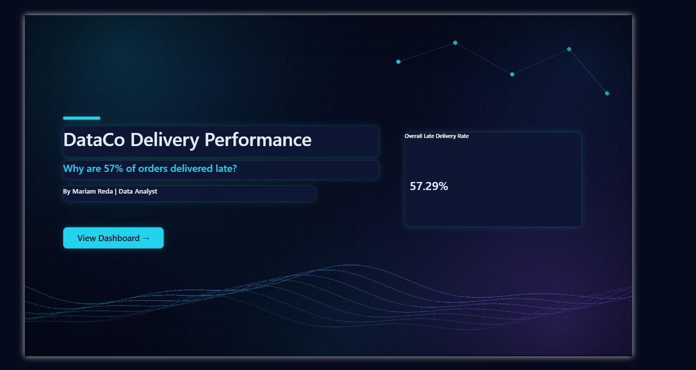
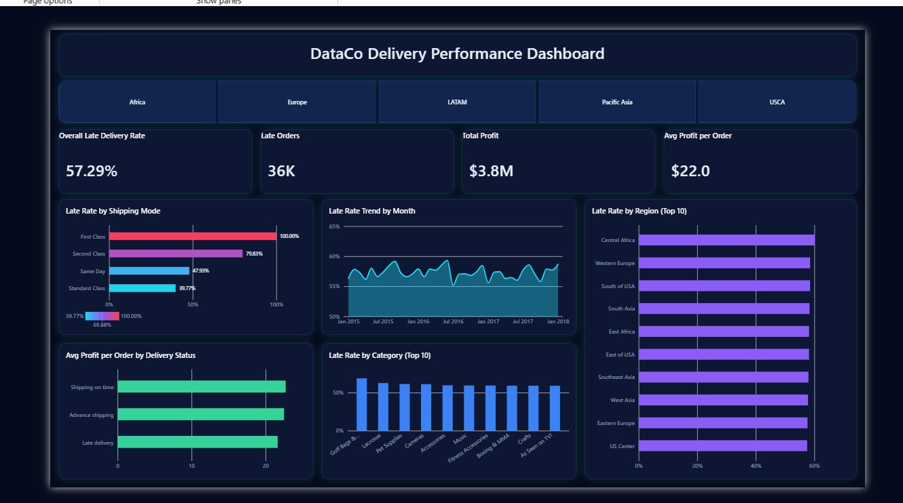

# Why are 57% of DataCo's orders late?

A Python and Power BI analysis of about 180K order lines from a global supply chain dataset.





## The short version

More than half of the orders in this dataset arrive late. 57.3%, to be exact.

I expected a messy story: a few bad regions, a busy season, maybe some product categories that are hard to ship. It wasn't any of that. Region, month, product category, order value and customer type all looked about the same.

One thing did stand out: **shipping mode**. First Class promises delivery in about one day, and in this data it was late **100% of the time**. Standard Class promises four days and was late about 40% of the time.

My recommendation is simple. The First Class promise doesn't look realistic. Either fix the process behind it, or change the promise.

## Why this project

I'm interested in logistics and e-commerce, so I went looking for a dataset in that space. I didn't want to just build a pile of charts, so I started with one plain question: why are so many orders late? Everything else in the project comes from trying to answer that.

## The data

- **Dataset:** DataCo Smart Supply Chain for Big Data Analysis
- **Authors:** Fabian Constante, Fernando Silva and António Pereira (2019), Mendeley Data, V5, DOI [10.17632/8gx2fvg2k6.5](https://doi.org/10.17632/8gx2fvg2k6.5). It's also available on Kaggle.
- **License:** CC BY 4.0, so credit goes to the original authors.
- **Size:** 180,519 rows, 65,752 orders, 20,652 customers, 164 countries, January 2015 to January 2018.

One thing to know before reading any number here: **each row is one product inside an order**, not a whole order. An order with three products is three rows. That matters when you count things (more on that below).

I haven't included the raw CSV in this repo (it's about 95 MB). You can download it from the links above.

## What I did to the data

- Dropped 8 columns I didn't need: two that were empty or almost empty (product description, order zipcode), two that were masked (customer email and password), three with personal details (first name, last name, street) and one with image links.
- Turned the order and shipping dates from text into real dates.
- Renamed all columns to `snake_case` so they're easier to work with.
- Left canceled shipments (7,754 rows) out of every late-rate calculation. A canceled order isn't late and it isn't on time, so it doesn't belong in the rate.

### Two mistakes I caught

**1. Countries with 100% and 0% late.** My first country-level result looked dramatic: some countries at 100% late, others at 0%. Then I looked at the row counts. Those countries had only a handful of rows each, so the numbers meant nothing. I kept only countries with at least 500 rows, and the spread dropped to about 52% to 63%.

**2. A "99K late orders" card that was wrong.** In Power BI, my first Late Orders card showed about 99K. That number is just the count of late *rows*. Since one order can have several rows, I was counting some orders more than once. Counting distinct order IDs gave about 36K, which matched my Python results:

```dax
Late Orders =
CALCULATE(
    DISTINCTCOUNT(dataco_clean[order_id]),
    dataco_clean[delivery_status] = "Late delivery"
)
```

## The questions I asked, and what I found

| # | Question | What I found |
|---|---|---|
| 1 | How often are orders late? | 57.3% of rows (canceled excluded). At order level, 36,048 of 62,897 orders had a late item, which is also 57.3%. |
| 2 | Does shipping mode matter? | Yes, a lot. First Class 100% late, Second Class 79.8%, Same Day 47.9%, Standard Class 39.8%. |
| 3 | Does region matter? | Barely. Regions range from 51.6% to 60.1%. |
| 4 | Does it change over time? | No. Every month sits between 55.2% and 59.3%, with no trend. |
| 5 | Does product category matter? | A little, but with no clear pattern. Categories range from 49.3% to 68.9%. |
| 6 | Does order value matter? | No. All four value brackets are between 57.1% and 57.6%. |
| 7 | Does customer segment matter? | No. Consumer, Corporate and Home Office are all about 57%. |
| 8 | Does lateness cost profit? | A little. Average profit per order line is $21.62 when late, against $22.71 when on time. |
| 9 | Does country matter? | Not much. After the 500-row filter, countries range from 51.6% to 62.9%. |

The scheduled delivery days help explain question 2: First Class promises 1 day, Second Class 2, Same Day 0 and Standard Class 4. First Class breaks the pattern, though. It promises one day and misses every time, while Same Day promises even faster delivery and is late less than half the time. That's why I read it as a problem with the promise itself.

## What the data can't tell me

- There are no reasons for the delays in this dataset (carrier, weather, warehouse). So "the First Class promise is unrealistic" is my reading of the numbers, not a proven cause.
- The profit difference is small, and I didn't test whether it's statistically significant.
- The data covers 2015 to 2018, so it describes that period only.

## The dashboard

The Power BI file has two pages: a cover and the dashboard itself.

- **KPI cards:** overall late rate (57.29%), late orders (36K), total profit ($3.8M) and average profit per order line ($22.0).
- **Market slicer** that filters the whole page.
- **Late rate by shipping mode**, with the bar colors scaled by late rate.
- **Monthly trend, top 10 regions, top 10 categories**, and **average profit by delivery status**.
- Canceled shipments are filtered out of the whole page.

The file is in `dashboard/Dashboard.pbix`.

## What's in this repo

```
dataco-delivery-performance/
├── README.md
├── notebook/
│   └── dataco_delivery_analysis.ipynb
├── dashboard/
│   └── Dashboard.pbix
└── images/
    ├── cover.png
    └── dashboard.png
```

## Run it yourself

1. Download the dataset from the links above and put `DataCoSupplyChainDataset.csv` next to the notebook.
2. Install what you need: `pip install pandas notebook`
3. Open the notebook and run the cells in order. The cleaning step saves `dataco_clean.csv`, which is the file Power BI reads.

## Tools

Python (Pandas), Jupyter, Power BI (DAX) and Excel.

## About me

I'm Mariam Reda, a data analyst based in Cairo. I have a BBA in Marketing and finished a Data Analysis Diploma at Route Academy in 2026. I'm looking for a junior data analyst role.

- [LinkedIn](https://www.linkedin.com/in/mariam-abdelsattar-6474b9421/)
- [GitHub](https://github.com/mariam17ra-sys)
